<div align="center">



<br/>


</div>

<br/>

### about

I'm **Lou** — a self-taught developer based in France, focused on the layer between hardware and the OS.

I spend most of my time reverse-engineering devices, writing drivers, and making stubborn hardware behave on **macOS** and **Linux**. The kind of work where a wrong register write is louder than a UI bug.

I like systems that feel invisible when they work: audio that just plays, a fingerprint reader that unlocks without drama, an EFI that boots clean. When something is broken at that level, I want to understand *why* — then fix it properly.

Outside of low-level work, I also build small desktop and kiosk experiences: tight UIs, careful UX, no fluff.

---

### how I work

```text
┌─ approach ─────────────────────────────────────────┐
│  1. reproduce the failure                          │
│  2. map the hardware path (ACPI / SPI / HID / SOF) │
│  3. isolate the minimal change that fixes it       │
│  4. document what actually matters                 │
└────────────────────────────────────────────────────┘
```

I learn by building. Docs help; a working driver teaches more.

---

<div align="center">

### toolkit



</div>

<p align="center">
  
  
  
  
  
  
</p>

---

<div align="center">

### activity


<br/>


</div>

---

<div align="center">

### connect

**Telegram** · [`@putin_real`](https://t.me/putin_real)  
**Discord** · `@octodevv5`


<sub>OctoDev Studios · France</sub>

</div>
