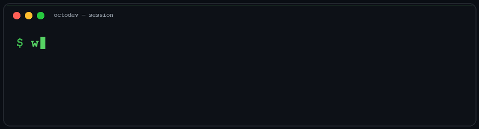

<div align="center">
  
  <br/><br/>
  
</div>

<br/>


### about

I'm **Lou** — a self-taught developer based in **France**, working at the boundary between hardware and the operating system.

Most of my time goes into reverse-engineering devices, writing drivers, and making stubborn silicon behave on **macOS** and **Linux**. Registers, interrupts, ACPI tables, HID reports — the quiet layer users never see, until it breaks.

I care about systems that feel invisible when they work: audio that just plays, unlock that just works, a boot path that stays boring. When something fails at that depth, I want the root cause — not a workaround taped on top.

I also design small desktop and kiosk experiences: dense, deliberate interfaces with no decorative noise.

---

### philosophy

| | |
| :--- | :--- |
| **Observe** | Reproduce the failure. No guessing. |
| **Map** | Trace the path — ACPI, SPI, HID, SOF, firmware. |
| **Cut** | Ship the smallest change that actually fixes it. |
| **Leave a trail** | Document what matters for the next person (often future me). |

Docs help. A working driver teaches more.

---

### toolkit

```text
 languages   C · Python · Kotlin · JavaScript · PHP
 systems     Linux · macOS internals · OpenCore / ACPI
 focus       drivers · audio · fingerprint · firmware · UX
```

<p align="center">
  
  
  
  
  
  
</p>

---

### signal

<div align="center">
  
  
  <br/>
  
</div>

---


<div align="center">

### connect

**Telegram** [`@putin_real`](https://t.me/putin_real)  
**Discord** `@octodevv5`

<br/>

<sub>◈ OctoDev Studios · France</sub>

</div>
